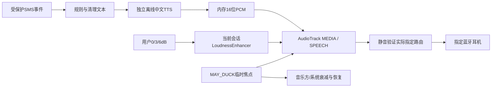

# 阶段1.1音频响度审计

日期：2026-11-15，Q1原链路审计。基线da5c70eaeb4787bdba1ab045e2b550dc172fb0cd；当前阶段只增加固定语句测量的测试APK，尚未修改正式PCM处理。没有读取短信历史、保存PCM/音频文件、采集第三方音乐或测量耳机SPL。

## 当前链路

TTS生成PCM后没有软件缩放或标准化；原0dB不创建增强器，3/6dB只创建绑定正音频session ID的LoudnessEnhancer。语音AudioTrack未调用setVolume/setStereoVolume，默认单位增益；源码中唯一setVolume(0f)用于前台端口刷新时自己的静音探测轨道，不是语音衰减，不修改系统STREAM_MUSIC。没有重复增益证据。

AudioTrack采用MODE_STREAM、PCM_16BIT、实际TTS采样率及对应MONO/STEREO channel mask；write为非阻塞。先写100ms零样本验证实际路由，再允许语音写入，每次写入仍核对许可、焦点、路由、8秒期限。前台/事件结束均走原统一清理。正式8000ms/5000ms/1MiB/80 UTF-16/1800ms及700ms预留保持。

## 原始PCM客观基线

固定公开语句A01“晚上七点见。”、A02“验证码，零零九八一。”、A03“短信语音测试，完整播放。”，三次独立原链路会话，用户增益临时设0后恢复原配置。不含真实SMS；source=FIXED_TTS_NOT_SMS。数据只在测试内存中短暂存在，报告只留标量。

有效区间口径：20ms窗RMS高于−50dBFS为有效窗，末窗按实际样本数计算；它是审计能量门限，不是语义VAD。整段RMS与有效RMS分开。True Peak为4倍、32 tap Hann窗sinc插值估计，不是认证dBTP测量；无声压计，所有dBFS均不得换算为耳机实际dB SPL。

| 样本 | PCM | 时长/字节 | 整段RMS | 有效RMS | Peak | True Peak估计 | Crest（有效） | DC offset | 满幅样本 | 静音比例 |
|---|---|---|---:|---:|---:|---:|---:|---:|---:|---:|
| A01 | 24kHz/单声道/16位 | 1466.7ms / 70400 | −21.987 | −20.738 | −7.416 | −7.388 | 13.322 | −0.000000884 | 0 | 25.00% |
| A02 | 同上 | 2346.7ms / 112640 | −21.432 | −20.133 | −8.056 | −8.032 | 12.077 | −0.000001817 | 0 | 25.85% |
| A03 | 同上 | 2706.7ms / 129920 | −21.277 | −20.133 | −6.390 | −6.378 | 13.743 | −0.000001435 | 0 | 23.15% |

满幅计数定义为绝对值达到32767/32768的样本数，是数字满幅指标，不能单凭零计数断言完全无失真。静音使整段RMS比有效窗低约1.1～1.3dB，因此不能只看整段或峰值判断响度。有效RMS三句差约0.61dB，未发现需要单独压缩器处理的巨大句间差异。

## 轨道、属性、蓝牙与焦点

实际观测usage=1（MEDIA）、contentType=1（SPEECH）、24kHz单声道、session ID为正、routedDeviceType=8（A2DP），严格实际路由确认通过。三次系统媒体音量读取均60→60。语音是短消息口述，继续MEDIA＋SPEECH；没有证据支持为增大音量改为ACCESSIBILITY或通信Usage。

焦点为AUDIOFOCUS_GAIN_TRANSIENT_MAY_DUCK、拒绝延迟授予、setWillPauseWhenDucked(true)；短暂焦点丢失暂停并按剩余预算恢复，永久丢失终止。音乐实际衰减由系统/音乐方实现，APP不设置音乐方音量。用户确认原版无音乐0dB仍偏小、无失真/爆音、手机无语音。

同三句音乐下原版0dB已测：有效RMS依次−20.696/−20.183/−20.103dBFS，Peak−7.428/−8.111/−6.352dBFS，满幅计数均0，实际路由仍A2DP，系统媒体音量三次60→60。与无音乐基线接近，未见源PCM随音乐出现额外衰减；差异在约0.05dB以内，不扩大成主观同响保证。音乐相对听感、降低/恢复等待本轮用户反馈；没有第三方音乐捕获权限，不测混音后音乐RMS或duck的实际dB数。

蓝牙绝对音量/耳机DSP/佩戴/听力/外部声压没有测量工具，不能排除这些影响，也不把原40→100异常归因于APP：用户本轮已明确其为本人手动调节，状态CLOSED_BY_USER_CLARIFICATION，原失败与复测保留。

平台参考：[AudioTrack](https://developer.android.com/reference/android/media/AudioTrack)、[音频焦点](https://developer.android.com/media/optimize/audio-focus)、[LoudnessEnhancer](https://developer.android.com/reference/android/media/audiofx/LoudnessEnhancer)。这些API依据不代替本机听感。

## 根因与最小方案（Q2候选，实施后必须真机验证）

已证实的贡献因素：当前0dB完全保留约−20dBFS有效语音，而三句峰值仍有6.4～8.1dB余量；没有APP额外衰减或重复缩放。结合用户“无音乐也偏小”的反馈，可在PCM内尝试温和基础提升。它不能证明耳机端唯一根因，更不能证明音乐duck不足。

候选：以三句中位有效RMS约−20.13dBFS为起点，先试约3dB基础提升（候选目标−17dBFS、上行最多6dB，低能量/静音不无限提升），不加独立动态压缩器；七档用户增益随后统一由PCM处理，使用最终峰值保护，避免与原LoudnessEnhancer重复叠加。高档位需要实测限幅与听感，名义每3dB并不承诺限幅后的有效RMS每档也增加3dB。

只有峰值可控、处理延迟符合原预算、0dB真机可听性改善后才把候选参数作为正式值。七档、音乐基线/优化后及主题尚未验收，不写PASS。优化前后指标、最终算法及未通过项将在此处继续追加。
