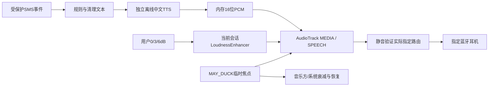

# 阶段1.1音频响度审计

**归档状态：CLOSED / ACCEPTED（2026-11-16）。** 用户已正式确认阶段1.1验收，测量口径、失败候选与适用边界原样保留。本次没有重新采集PCM或执行设备测试。[正式关闭报告](stage1.1-closure-report.md)。

日期：2026-11-15～16，Q1原链路审计及最终局部优化复核。基线da5c70eaeb4787bdba1ab045e2b550dc172fb0cd；Q1先只增加固定语句测量的测试APK，提交5434df961515e87a346559602840a27fd2e12963后才开始修改正式PCM处理；以下原链路及原始测量永久保留。没有读取短信历史、保存PCM/音频文件、采集第三方音乐或测量耳机SPL。

## 当前链路

TTS生成PCM后没有软件缩放或标准化；原0dB不创建增强器，3/6dB只创建绑定正音频session ID的LoudnessEnhancer。语音AudioTrack未调用setVolume/setStereoVolume，默认单位增益；源码中唯一setVolume(0f)用于前台端口刷新时自己的静音探测轨道，不是语音衰减，不修改系统STREAM_MUSIC。没有重复增益证据。

AudioTrack采用MODE_STREAM、PCM_16BIT、实际TTS采样率及对应MONO/STEREO channel mask；write为非阻塞。先写100ms零样本验证实际路由，再允许语音写入，每次写入仍核对许可、焦点、路由、8秒期限。前台/事件结束均走原统一清理。正式8000ms/5000ms/1MiB/80 UTF-16/1800ms及700ms预留保持。

## 原始PCM客观基线

固定公开语句A01“晚上七点见。”、A02“验证码，零零九八一。”、A03“短信语音测试，完整播放。”，三次独立原链路会话，用户增益临时设0后恢复原配置。不含真实SMS；source=FIXED_TTS_NOT_SMS。数据只在测试内存中短暂存在，报告只留标量。

有效区间口径：20ms窗RMS高于−50dBFS为有效窗，末窗按实际样本数计算；它是审计能量门限，不是语义VAD。整段RMS与有效RMS分开。True Peak为4倍、32 tap Hann窗sinc插值估计，不是认证dBTP测量；无声压计，所有dBFS均不得换算为耳机实际dB SPL。

| 样本 | PCM | 时长/字节 | 整段RMS | 有效RMS | Peak | True Peak估计 | Crest（有效） | DC offset | 满幅样本 | 静音比例 |
|---|---|---|---:|---:|---:|---:|---:|---:|---:|---:|
| A01 | 24kHz/单声道/16位 | 1466.7ms / 70400 | −21.987 | −20.738 | −7.416 | −7.388 | 13.322 | −0.000000884 | 0 | 25.00% |
| A02 | 同上 | 2346.7ms / 112640 | −21.432 | −20.133 | −8.056 | −8.032 | 12.077 | −0.000001817 | 0 | 25.85% |
| A03 | 同上 | 2706.7ms / 129920 | −21.277 | −20.133 | −6.390 | −6.378 | 13.743 | −0.000001435 | 0 | 23.15% |

满幅计数定义为绝对值达到32767/32768的样本数，是数字满幅指标，不能单凭零计数断言完全无失真。静音使整段RMS比有效窗低约1.1～1.3dB，因此不能只看整段或峰值判断响度。有效RMS三句差约0.61dB，未发现需要单独压缩器处理的巨大句间差异。

## 轨道、属性、蓝牙与焦点

实际观测usage=1（MEDIA）、contentType=1（SPEECH）、24kHz单声道、session ID为正、routedDeviceType=8（A2DP），严格实际路由确认通过。三次系统媒体音量读取均60→60。语音是短消息口述，继续MEDIA＋SPEECH；没有证据支持为增大音量改为ACCESSIBILITY或通信Usage。

焦点为AUDIOFOCUS_GAIN_TRANSIENT_MAY_DUCK、拒绝延迟授予、setWillPauseWhenDucked(true)；短暂焦点丢失暂停并按剩余预算恢复，永久丢失终止。音乐实际衰减由系统/音乐方实现，APP不设置音乐方音量。用户确认原版无音乐0dB仍偏小、无失真/爆音、手机无语音。

同三句音乐下原版0dB已测：有效RMS依次−20.696/−20.183/−20.103dBFS，Peak−7.428/−8.111/−6.352dBFS，满幅计数均0，实际路由仍A2DP，系统媒体音量三次60→60。与无音乐基线接近，未见源PCM随音乐出现额外衰减；差异在约0.05dB以内，不扩大成主观同响保证。用户随后确认有音乐时没有更难听清，只是语音本身仍小，音乐降低/恢复正常、无失真/爆音、手机无语音；没有第三方音乐捕获权限，不测混音后音乐RMS或duck的实际dB数。

蓝牙绝对音量/耳机DSP/佩戴/听力/外部声压没有测量工具，不能排除这些影响，也不把原40→100异常归因于APP：用户本轮已明确其为本人手动调节，状态CLOSED_BY_USER_CLARIFICATION，原失败与复测保留。

平台参考：[AudioTrack](https://developer.android.com/reference/android/media/AudioTrack)、[音频焦点](https://developer.android.com/media/optimize/audio-focus)、[LoudnessEnhancer](https://developer.android.com/reference/android/media/audiofx/LoudnessEnhancer)。这些API依据不代替本机听感。

## 根因与最小方案（Q2初始候选，原文保留）

已证实的贡献因素：当前0dB完全保留约−20dBFS有效语音，而三句峰值仍有6.4～8.1dB余量；没有APP额外衰减或重复缩放。结合用户“无音乐也偏小”的反馈，可在PCM内尝试温和基础提升。它不能证明耳机端唯一根因，更不能证明音乐duck不足。

候选：以三句中位有效RMS约−20.13dBFS为起点，先试约3dB基础提升（候选目标−17dBFS、上行最多6dB，低能量/静音不无限提升），不加独立动态压缩器；七档用户增益随后统一由PCM处理，使用最终峰值保护，避免与原LoudnessEnhancer重复叠加。高档位需要实测限幅与听感，名义每3dB并不承诺限幅后的有效RMS每档也增加3dB。

只有峰值可控、处理延迟符合原预算、0dB真机可听性改善后才把候选参数作为正式值。七档、音乐基线/优化后及主题尚未验收，不写PASS。优化前后指标、最终算法及未通过项将在此处继续追加。

## 三轮参数验证与最终方案

不把初始候选当成已验证正式值。三轮均为固定公开语句、同一指定耳机、媒体音量60，source=FIXED_TTS_NOT_SMS；每轮完成后恢复原增益配置。未保存PCM或音频文件。

| 轮次 | 目标/基础提升上限 | 实际有效RMS dBFS（三句） | 处理耗时 | 客观满幅 | 用户反馈/结论 |
|---|---|---|---|---|---|
| 初试 | −17 / +6dB | −17.000 / −17.000 / −17.041 | 46～83ms | 0 | 仍偏小，无失真/爆音/手机语音；未达到响度目标，保留原结果 |
| 第二轮 | −14 / +6dB | −14.841 / −14.281 / −14.447 | 47～80ms | 0 | 比原版清楚，但希望更大；非最终参数 |
| 最终轮 | −12 / +9dB | −12.450 / −12.308 / −12.689 | 45～99ms | 0 | 音量合适、自然，无明显压缩感、失真/爆音或手机语音 |

最终轮三句基础增益分别8.740/8.136/8.195dB，最小Limiter倍率0.685/0.785/0.643，峰值估计−1.930/−1.915/−1.907dBFS。有效RMS提升约8dB而峰值仍受控，不是直接把PCM乘常数后硬削顶。不能据此声称所有未来短信/耳机/环境都达到相同听感，或测得耳机SPL。

实际算法：20ms能量窗（−50dBFS）统计有效RMS，基础目标−12dBFS，增益限于−12～+9dB；整段低能量旁路，不把静音/低底噪无限放大。基础增益后合并用户增益，再算声道联动的所需峰值减益；反向5ms时间常数预判和前向50ms释放使减益平滑，样本目标−2dBFS。输出再以4倍32 tap插值估计峰值，必要时整段平滑无跳变的统一衰减至−1.2dBFS估计上限，最后16位量化。它不是认证true-peak limiter/LUFS测量；未使用逐点硬削顶或独立宽带压缩器。

处理在既有SpeechSession worker、完整PCM校验后、申请焦点和轨道前运行。字节数/时长/格式不变；处理时间计入原8秒，后续重新检查剩余预算，不足整条拒绝。处理或许可失效不会开始播放；取消会中断处理并清零私有内存，不复活旧回调。原硬件LoudnessEnhancer和SessionLoudness已移除，避免在最终峰值保护之后再施加不可观测增益；不依赖设备音效支持或修改全局音量。

## 用户最终保留四档与测量

先完成七档无音乐固定语音客观测量；随后用户明确只保留0/3/6/9，移除12/15/18。它是本轮后续范围决定，不能把移除的三档虚构为听感失败或正式PASS。七档原输出loudness-seven-no-music.txt/json留在本机忽略的build证据目录；正式四档沿用同一DSP参数，移除只改变UI、允许值和候选高档的向下迁移。

以下同一句A03分别以原生TTS新会话合成，存在微小自然波动，不是逐位相同PCM。每项均实际确认指定A2DP路由、完整播放/焦点释放、媒体音量60→60，满幅0。无音乐四档用户确认完整清楚、无失真/爆音或明显压缩感、无手机语音；音乐四档用户同样确认，音乐每次降低并恢复。

| 用户档位 | 无音乐有效RMS | 无音乐TP估计 | 音乐有效RMS | 音乐TP估计 | 处理耗时（无/有音乐） |
|---|---:|---:|---:|---:|---|
| 0dB | -12.762 | -1.853 | -12.792 | -1.868 | 155 / 119ms |
| 3dB | -10.783 | -1.890 | -10.798 | -1.819 | 43 / 47ms |
| 6dB | -9.599 | -1.841 | -9.634 | -1.814 | 44 / 45ms |
| 9dB | -9.670 | -1.200 | -9.092 | -1.278 | 51 / 45ms |

名义每档+3dB在未触发保护的低幅测试信号中验证；最终真实TTS的有效RMS不保证每档+3dB。高档位限制更强，插值峰值统一衰减还可能导致相邻档RMS不单调（无音乐9略低于6；历史15低于12）。已在UI提示保护会限制实际提升，不宣称实测等间隔或用削波换成功率；当前四档实际听感得到用户确认。

5秒/48k双声道960000字节人工高峰PCM仅处理不播放：本机432ms，低于既有700ms参考余量，满幅0、TP估计受控。它不是所有冷启动/CPU负载下的上界，实际会话仍必须用剩余预算门禁，不能扩容字符、PCM或广播时间。单元正弦残差检查不是耳机失真仪测量；主观失真/爆音结论限本轮固定句和目标耳机。

## 证据与隐私

原版两组：loudness-original-audit.txt/json、loudness-original-music-audit.txt/json；三轮：loudness-processed-zero-audit、loudness-target14-zero-audit、loudness-target12-zero-audit；最终增益：loudness-seven-no-music、loudness-four-music；UI/最大PCM：four-ui-worstcase-device.txt。均位于app/build/stage1.1-device，原始失败输出不覆盖。公开文档只留标量/固定句，不留真实短信、联系人、号码或音频。固定测试的DEBUG_SIMULATION不是受保护SMS广播；本轮真实SMS回归另记事件与finish，不从这些固定测试推导广播生命周期通过。

最终真实SMS-000124/125在+3dB、Home/锁屏、音乐、重启不开APP和断USB条件下完成，用户含联系人完整/duck恢复/无手机语音；处理阶段321/101ms，finish3667/3644ms，资源先于finish。详细时间点见测试结果，不从PCM指标推断耳机SPL。
