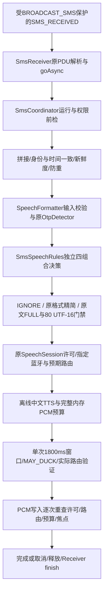

# V2.0 阶段1技术实现与交付报告

日期：2026-11-15（Asia/Shanghai）。**当前验收结论 PASS**，限已验证的vivo设备和配置。四组合真实短信及18项人工验收目标全部通过；末轮焦点失败修复后，重启/断USB/静置10分钟组合条件已实际复测。工程结果见[测试结果](stage1-test-results.md)，逐项放行条件见[验收报告](stage1-acceptance.md)，边界见[已知问题](stage1-known-issues.md)。具备进入阶段2的条件，本轮未启动阶段2。

## 检查与最小方案

- 开始时分支 `feature/v2-message-notifications`，HEAD/跟踪分支均为阶段0最终提交 `63f531f125ae4fc5bf0880a55f3a77d0df8ef7d1`，工作区干净；已成功fetch。
- origin为既有GitHub仓库；本地main与V1.0归档基线 `c76a5bf9d19bade0174d4dec3bc8e3eb06e7559a` 保留，验收实现 `355356c780bc65dcd3a3c2d91309eb4a24b8c029` 存在。
- 已阅读README、V1.0需求/报告/最终验收及剩余表、Debug工具说明、V2.0阶段0交付和五份正式依据。V2.0独立规则一致，未发现需另行决定的本阶段产品冲突。旧V1.0依赖行为由本次需求替换，旧记录不改。
- 已检查SmsReceiver、SmsCoordinator、SmsAssembly/ReplayGuard、OtpDetector/OtpParser、SpeechFormatter、SettingsRepository/PreferenceSettingsStore、Compose、SpeechSession/FocusGate、BluetoothProbe/RoutePolicy、现有JVM/androidTest及两个设备脚本。旧OtpParser为历史模板；当前业务使用OtpDetector，不替换识别算法。
- 原问题精确位于三处：formatter在筛选关闭时直接全文；setSimplify有筛选开启门槛；UI禁用精简开关且只有三种状态说明。两个设置值本来已各自保存，无需新增迁移。

## 现有链路及修改点

模拟仅在androidTest以人工fixture从解析后的SmsPart进入同一个SmsCoordinator；不发送SMS_RECEIVED，不创建生产注入入口。受控协调器选文测试和真实PCM模拟明确分开标注。

首批规则修改仅三个文件；末轮真实验收发现启动焦点竞争阻塞后，另增加一次启动常量修复，最终四个生产文件：

| 文件（仓库相对路径） | 修改 |
|---|---|
| `app/src/main/java/com/mxy1021/smsvoiceassistant/sms/AnnouncementRules.kt` | 增加纯Kotlin SmsSpeechMode/SmsSpeechRules；formatter先识别再按四组合选文；复用原精简格式及全文门禁 |
| `app/src/main/java/com/mxy1021/smsvoiceassistant/settings/SettingsRepository.kt` | 去除setSimplify的筛选依赖，继续同一锁/StateFlow/许可代次/存储更新 |
| `app/src/main/java/com/mxy1021/smsvoiceassistant/MainActivity.kt` | 精简开关始终可操作，说明独立；四种实际状态提示，仍通过原仓库更新并取消旧会话 |
| `app/src/main/java/com/mxy1021/smsvoiceassistant/audio/SpeechStartPolicy.kt` | 末轮实测修复：单次接收起焦点窗口1200→1800ms；延迟计算方法不变，不在失焦后抢焦点/重试，不改SpeechSession |

输入/总开关门禁优先；可靠OTP且精简开返回SIMPLIFIED；非可靠OTP且筛选开返回IGNORE；其余FULL。纯规则层不把安全拒绝冒充全文完成，formatter和音频层各自执行原门禁。完整行为表见[需求](stage1-requirements.md)。

OtpExtractor识别代码、PcmBudget常量及实现与阶段0基线逐字比较一致；SmsReceiver、SmsCoordinator、SpeechSession、BluetoothProbe、RoutePolicy、BootReceiver及上表之外的生产文件不改。

## 末轮真实焦点失败与有界修复

R03/R10首轮有效场景：用户重启、首次解锁未开APP、断USB锁屏静置15分钟，系统收到SMS但无可听语音。真实SMS-000083已有完整141440字节/2947ms PCM、实际路由匹配；接收后约1267ms取得焦点、1423ms首次写入、1435ms临时失焦、6757ms恢复，剩余约1241ms不足以播放约3004ms剩余音频及清理余量，于约6785ms终结。写入仅4800字节。用户FAIL与日志一致，不改写为通过。

开机计数74→75、保存启用/恢复状态正常；Application由开机流程在启动后约50秒初始化，SMS在约916725ms到达，接收时APP非前台/interactive=false/keyguard=true。没有用本次记录声称SmsReceiver独立冷启动了进程。具体抢占包未核验，不推测短信通知实现或声长。

先加androidTest `NotificationDelayedStartup`：在解析后约1400ms申请真实Android通知USAGE竞争焦点，保持5322ms。原1200ms策略实际[-3,1]、仅写4800字节、剩余预算不足，正向投递断言FAIL；不是伪造回调/真实SMS。随后仅把SpeechStartPolicy常量改为1800ms，保持从接收起算、TTS并行、不追加第二次等待、原始路由/许可/预算检查。专项在修复后完整写135680字节、路由匹配、释放成功，自动断言PASS。

真实最终复测：先以SMS-000084在锁屏/音乐下完整播放141440字节/2947ms，用户确认完整、音乐降低恢复、无泄漏；再按原条件重启、解锁后不开APP、断USB锁屏静置10分钟，用户确认两条新SMS及时完整无手机语音。启动计数75→76，保存C/运行/开机恢复及原目标身份保留。SMS-000085/86接收时均APP非前台、interactive=false、keyguard=true，分别完整95360/141440字节，约4128/4933ms广播终结，实际路由匹配，无临时失焦。此轮实际短信经全文路径完成，验证码精简的真实证据独立见H01/H05，不推测正文或识别结果。R03/R10最终PASS，原FAIL永久保留。

1800ms为本次已测约1435ms竞争提供有界余量，不保证任意晚到/任意长焦点占用。5秒完整PCM在快初始化条件下仍可满足8秒预算；其余情况仍整条拒绝。MAY_DUCK、MEDIA+SPEECH、setWillPauseWhenDucked、失焦暂停、合法GAIN恢复、永久丢失取消均不改，符合[Android音频焦点处理说明](https://developer.android.com/media/optimize/audio-focus)。

## 配置与升级

继续使用 `stage0` SharedPreferences和原有两个布尔键、`target`、运行/开机恢复等键。setOtpOnly只改筛选字段，setSimplify只改精简字段；现有update原子写入完整设置快照。默认均true；不新增设置版本，不清除未知旧键，不改变启动对账。

进程重建继续从持久化快照读取；SharedPreferences.apply的内存同步/磁盘异步机制不变。本轮增加真实Preferences和受控进程重建证据，不将对象重建等同于自然系统回收。规则变化沿用许可generation失效，旧PCM无法在切回原值后复活；Compose沿用显式cancel。

已核验V1.0安装版本为 `2 / 0.1.0-stage1`，新Debug与旧已安装APK的签名证书SHA-256一致。使用正常 `install -r` 成功升级到 `3 / 2.0.0-stage1`，两个规则、运行、开机恢复、设置完成状态和目标身份保持一致。证书为公开信息；设备地址/指纹/序列号不提交。

Release沿用原未配置发布签名的构建行为，产物为 `app-release-unsigned.apk`；本轮没有配置或替换签名密钥，实际保留数据升级验证使用与既有V1.0同签名的Debug APK。Release构建通过不代表已完成签名发布。

## 测试与脚本变更文件

修改：

- `app/src/test/java/com/mxy1021/smsvoiceassistant/AnnouncementRulesTest.kt`：旧“全收时总是全文”的断言改为精简关闭的全文场景。
- `app/src/test/java/com/mxy1021/smsvoiceassistant/SettingsRepositoryTest.kt`：依赖断言改独立，增加四组合升级、快速更新重建及旧许可失效覆盖。
- `app/src/test/java/com/mxy1021/smsvoiceassistant/SpeechStartPolicyTest.kt`：窗口边界更新及1435ms反例/原8秒预算覆盖，最终共79项单测（首批78）。
- `app/src/androidTest/java/com/mxy1021/smsvoiceassistant/DebugSmsInjectionTest.kt`：D00独立持久化预期、RuleMatrix八条、筛选关闭时SimplifyDuring、NotificationDelayedStartup专项，正常setter和finally恢复；已有通知先持焦点用例保持窗口前后重叠条件。
- `scripts/Test-DebugSms.ps1`：增加RuleMatrix/SimplifyDuring/NotificationDelayedStartup允许的fixture ID，保留已安装APK摘要/runner/Debug校验。
- `scripts/Test-Stage1Device.py`：UI smoke改为四组合独立保存与还原检查，保留只读无参数行为。
- `scripts/Verify-DebugSmsIsolation.py`：把新增instrumentation类纳入正式DEX排除及测试DEX存在检查。
- `README.md`：当前V2.0规则和待验收入口，V1.0历史结果明确归属。

新增：

- `app/src/test/java/com/mxy1021/smsvoiceassistant/IndependentSmsRulesTest.kt`：10项规则测试，S01～S04独立，含失败/歧义/空文本/全文预算/原文完整/快速切换。
- `app/src/androidTest/java/com/mxy1021/smsvoiceassistant/IndependentSmsRulesDeviceTest.kt`：7项；4种协调器受控选文测试、3项真实测试私有Preferences测试。
- 本目录六份阶段1文档：`stage1-requirements.md`、`stage1-report.md`、`stage1-test-plan.md`、`stage1-test-results.md`、`stage1-acceptance.md`、`stage1-known-issues.md`。

## Git与交付边界

功能提交：`4b48e04`（`feat(sms): implement independent speech rule switches`），通过Debug构建及78项单测后提交。测试提交：`16b6b140dec0f37ab6cfef7366c456bf4cd2feb7`（`test(sms): add independent speech rule coverage`），设备JUnit、四组合模拟及回归断言通过后提交。真实阻塞修复提交：`b75f371d375673f1c0d6f328fac6faf264f0c1b8`（`fix(audio): cover delayed SMS startup focus collision`），在反例先FAIL、修正后79单测/18设备JUnit/受影响fixture断言通过后提交。文档提交与最终推送核验记录见[验收报告](stage1-acceptance.md)及最终交付回复，文档提交自身SHA不自引用。

版本号、构建配置、包身份、签名配置、原Manifest和V1.0历史文档均保持不变；不新建标签、不合并main、不强推。临时证据只存被忽略的 `app/build/v2-stage1/` 及构建日志，不提交真实SMS/验证码/号码/设备身份/密钥/音频。
